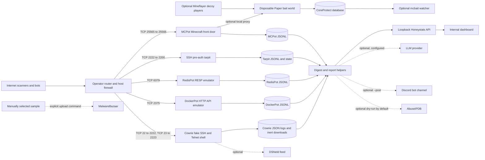

# Architecture

## Boundaries

- RedisPot and DockerPot have no upstream server. Their responses and identifiers are synthetic. They do not invoke Redis persistence, the Docker daemon, or attacker commands.
- Cowrie is isolated in a container. Its fake shell can still make actual outbound requests to attacker-supplied download URLs; captured files stay in the configured volume and are not executed by this bundle.
- MCPot parses the Minecraft handshake before deciding whether to answer locally or proxy. If MCPOT_UPSTREAM is configured, visitor traffic reaches Paper. The Paper process and world are real and writable.
- The tarpit holds real TCP sockets and sends generated bytes, but does not negotiate SSH or accept commands.
- Reporting tools read local event files. When enabled, LLM, Discord, AbuseIPDB, DShield, and MalwareBazaar integrations make external requests as described in [operations.md](operations.md).
